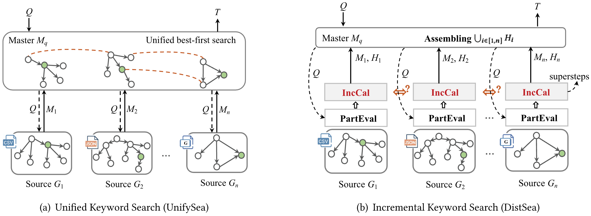

# Exploring Heterogeneous Data Lake Based on Canonical Graphs

Efficiently querying and analyzing heterogeneous data enables users to gain more complete insights. Two progressive methods are novely proposed to address the problem of distributed keyword search across heterogeneous data sources. To effectively perform keyword search over the data lake, we first develop a best-first search algorithm called UnifySea, which explores the answers across different sources based on the unified identification of related instances. To further improve the query efficiency, we propose a novel incremental keyword search algorithm called DistSea, which incrementally calculates the optimal answers based on locally partial evaluation. Equipped with several efficient pruning rules, DistSea reduces unpromising tree calculation across different sources. 

For more technical details, see [Exploring Heterogeneous Data Lake Based on Canonical Graphs](https://dl.acm.org/doi/pdf/10.1145/3772001) and [Exploring heterogeneous data lake based on unified canonical graphs](https://dl.acm.org/doi/pdf/10.1145/3477495.3531759).




## Floder Structure
```text
Ksearch/
├── data/
├── cache/
├── bert-base-uncased/
└── search.py
└── processor.py
└── datahandler.py
```

## Dependencies and Installion
```
numpy==1.24.1
pandas==2.0.3
scipy==1.10.1
tokenizers==0.20.3
huggingface-hub==0.33.4
torch==2.1.0+cu118
torchaudio==2.1.0+cu118
torchvision==0.16.0+cu118
tqdm==4.67.1
transformers==4.46.3
```


## Quick Start
This is a demo of how to set up Ksearch locally. To get a local copy up, running these simple steps.

### Prerequisites
We recommend creating a new conda environment to install the dependencies:
```
conda env remove --name search
conda create -y -n search python=3.9
conda activate search
```

### Prepare Datasets
Six datasets are obtained from four benchmarks. The detailed instructions for downloading are shown below. Please follow it before running or developing algorithms.
- [Machamp](https://dl.acm.org/doi/abs/10.1145/3459637.3482008): Three real-world benchmark datasets Rel-Heter, SemiHeter, and Semi-Homo with different structures are used. 
- [Geo-Heter](https://dl.acm.org/doi/abs/10.1145/3485447.3512026): It is a geospatial dataset collected from three real-world location-based services: Yelp, Foursquare, and OpenStreetMap. 
- [Unibench](): It is a multi-source benchmark in a social commerce scenario, including Customer table, Product table, Order Json document and transaction graph. 
- [DrugBank](https://drugcentral.org/download): This is extracted from DrugBank Central and ChEMBL database. The relational model includes eight tables to present drug, target, ChEMBL information, and so on. The interaction data of drugs and targets are modeled as a graph.

### Prepare the pretrained models
- We use bert-base-uncased as the pretrained language model in all experiments. You can download the pre-trained checkpoint from [Google-BERT](https://huggingface.co/google-bert/bert-base-uncased) manually.
- We set the default matching model as [PeomptEM](https://github.com/ZJU-DAILY/PromptEM) for all datasets. You can set it up to create generalized entity matching sets.

### Keyword search
To perform keyword search with DistSea.
```
python search.py [<args>] [-h | --help]
```
e.g.
```
python search.py -d=rel-heter -w=2
```

## Citation
If you find our work useful, please kindly cite the following papers:

```
@article{yuan2025exploring,
  title={Exploring Heterogeneous Data Lake Based on Canonical Graphs},
  author={Yuan, Qin and Yuan, Ye and Wen, Zhenyu and Wang, Guoren},
  journal={ACM Transactions on Information Systems},
  volume={44},
  number={2},
  pages={1--29},
  year={2025},
  publisher={ACM New York, NY}
}

@inproceedings{yuan2022exploring,
  title={Exploring heterogeneous data lake based on unified canonical graphs},
  author={Yuan, Qin and Yuan, Ye and Wen, Zhenyu and Wang, He and Chen, Chen and Wang, Guoren},
  booktitle={Proceedings of the 45th international ACM SIGIR conference on research and development in information retrieval},
  pages={1834--1838},
  year={2022}
}
```


<br>
<br>
<br>
<br>
<br>
<br>


